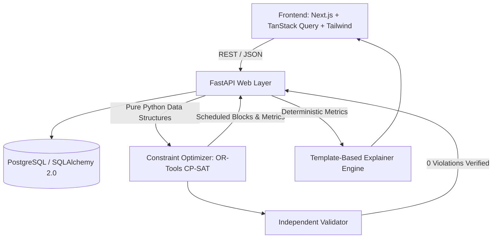

# UnityTrack Architecture Specification

## 1. System Vision

Indian Railways maintenance planning currently operates in departmental silos:
- **Engineering (Civil / Track)** requests line blocks for track renewal, ballast tamping, and weld maintenance.
- **Traction Distribution (TRD / Electrical)** requests power blocks to de-energize overhead lines (OHE) for catenary repair.
- **Signal & Telecom (S&T)** requests maintenance windows for points, track circuits, axle counters, and signals.

Because these departments plan independently, railway corridors suffer redundant line blocks, fragmented maintenance windows, and excessive passenger/freight train delays.

**UnityTrack** acts as the cross-departmental intelligence layer:
1. It ingests maintenance tasks from all three departments.
2. It assigns an explainable priority score (0-100) based on criticality, defect severity, overdue ratio, and traffic impact.
3. It bundles compatible tasks (e.g., S&T tasks that can safely ride inside a TRD power-off block) to minimize track block requests.
4. It formulates a constraint optimization problem solved via Google OR-Tools CP-SAT to schedule maintenance blocks that fit between train timetable slots.
5. It outputs transparent metrics, schedules, and counterfactual what-if comparisons.

---

## 2. Component Boundaries

### Strict Optimizer Independence Guarantee
The optimizer located in `backend/app/optimizer` is strictly decoupled from the rest of the application:
- **Zero FastAPI dependencies**: No routers, Request/Response objects, or HTTP exception classes.
- **Zero Database dependencies**: No SQLAlchemy models, sessions, or queries.
- Input data structures are plain Python dataclasses or Pydantic models.
- This allows 100% isolated unit testing and benchmarking without running database migrations or web servers.

---

## 3. Contract & Type Safety Architecture

- Backend routes and schemas define the single source of truth.
- `app.export_openapi` dumps the exact OpenAPI 3.1 schema to `backend/openapi.json`.
- `openapi-typescript` translates the schema directly to `frontend/src/lib/api-types.ts`.
- The frontend typed client (`frontend/src/lib/api-client.ts`) directly imports these generated types.
- Manual hand-written API types are prohibited to prevent schema drift.

---

## 4. Verification & Quality Gates

Every stage of UnityTrack is guarded by automated checks:
- **Backend**: `pytest` (unit & integration), `ruff check` (linting), `mypy` (strict static typing).
- **Frontend**: `vitest` (component & math tests), `eslint` (code style), `tsc --noEmit` (TypeScript typecheck).
- **CI**: Automated GitHub Actions workflow runs the full suite on Ubuntu + PostgreSQL containers on every commit and pull request.
